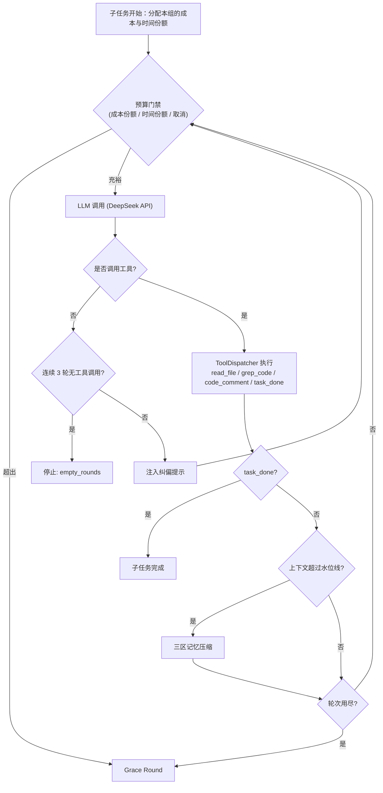
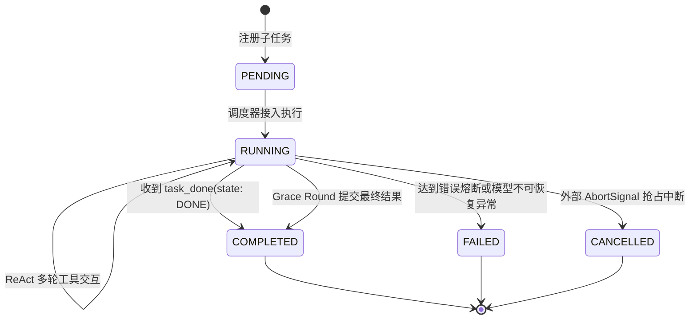

# Agent Runtime 运行时架构

> 本文说明 PR-Agent 自研 Agent Runtime 的调度循环、预算控制、兜底轮与稳定性机制。

## 1. 调度循环

PR-Agent 不依赖通用 Agent 框架，而是针对代码审查实现了一个专用的 ReAct 循环（[`src/runtime/engine.ts`](../../src/runtime/engine.ts)）。一个 PR 的 Diff 先按目录拆分为若干文件组，每组作为一个子任务依次执行：



### 停止原因（`MainLoopStop`）

每个子任务结束时都会记录停止原因，写入检查点、`ReviewRunResult.groups` 与评测结果：

| 停止原因       | 含义                                                 | 是否执行 Grace Round |
| :------------- | :--------------------------------------------------- | :------------------- |
| `none`         | 模型调用 `task_done` 正常结束                        | —                    |
| `max_rounds`   | 本组达到安全上限 `limits.maxRounds`（默认 100）      | 是                   |
| `cost_budget`  | 本组花费达到其成本份额                               | 是                   |
| `timeout`      | 本组用完其时间份额                                   | 是                   |
| `empty_rounds` | 模型连续 3 轮不调用任何工具                          | 否                   |
| `compression`  | 压缩后上下文仍超过水位线，安全停止                   | 否                   |
| `llm_error`    | LLM 调用在重试后仍失败；只结束本组，其他组的结果保留 | 否                   |

## 2. 预算控制

**源码**：[`src/runtime/budget.ts`](../../src/runtime/budget.ts)、[`src/llm/pricing.ts`](../../src/llm/pricing.ts)

预算分为两类，职责互不重叠；轮次不属于预算：

- **花费与时间**：限制一次 PR 审查能花多少钱、多长时间。
- **上下文窗口**：只决定何时压缩记忆，不限制花费。

| 配置项             | 作用                                               |
| :----------------- | :------------------------------------------------- |
| `maxCostUsd`       | 单次 PR 审查的花费上限（美元），`0` 表示不限       |
| `totalTimeoutMs`   | 单次 PR 审查的总时长上限                           |
| `roundTimeoutMs`   | 单次 LLM 调用的超时，超时按可重试错误处理          |
| `maxContextTokens` | 用于压缩判断的上下文窗口                           |
| `warningWatermark` | 上下文超过窗口的该比例时触发压缩                   |
| `softWatermark`    | 预留：用于后续的非阻塞后台压缩，当前不触发任何行为 |

默认值见 [配置参考](../guides/configuration-reference.md#32-预算控制配置-budget)。

轮次上限 `limits.maxRounds`（默认 100）是防止失控循环的安全底线，而不是预算维度：正常审查应当由模型调用 `task_done` 结束，花费由 `maxCostUsd` 约束。触发该上限时同样执行 Grace Round，并以 `max_rounds` 记录，评测中出现它说明 Agent 行为异常，而不是预算不足。

### 2.1 成本计算

DeepSeek API 只返回 Token 用量，不返回费用。客户端根据响应中的 `prompt_cache_hit_tokens` 把输入拆成缓存命中与未命中两部分，按[官方价格表](https://api-docs.deepseek.com/quick_start/pricing)分别计价，再加上输出费用：

```text
cost = hit × 命中单价 + (prompt − hit) × 未命中单价 + completion × 输出单价
```

价格表维护在 `src/llm/pricing.ts`，按调用时刻区分峰值与低谷时段（低谷为半价）。中国法定节假日同样属于低谷时段，但未建模，按峰值计价，因此成本只会高估、不会低估。配置了价格表之外的模型时，客户端在构造时直接报错，而不是按零成本运行。

记忆压缩本身的 LLM 调用也计入花费。

### 2.2 按组公平分配

成本和时间预算以整个 PR 为单位，但按"剩余预算 ÷ 剩余组数"分给每个文件组：

```text
本组成本份额 = 已花费 + (maxCostUsd − 已花费) / 剩余组数
本组截止时间 = 现在 + (总截止时间 − 现在) / 剩余组数
```

这样一个开销大的组不会耗尽后面所有组的预算；前面的组没用完的部分会自动顺延给后面的组，最后一组可以使用全部剩余预算。

Grace Round 在份额用完之后执行，所以一次审查的实际花费可能略高于 `maxCostUsd`，超出部分约为每个被截断的组多一次 LLM 调用。

## 3. Grace Round 与 KV Cache 保护

当成本或时间份额用完、或触发轮次安全上限时，模型往往已经发现了问题但还没提交。运行时会在结束前追加一轮：

1. 注入提示，告知只能调用 `code_comment` 或 `task_done`。
2. 请求中**保持完整的工具定义不变**。如果此时删掉 `read_file`、`grep_code`，请求前缀就会改变，DeepSeek 的前缀缓存将全部失效。
3. 在执行层过滤：模型若仍调用探索类工具，直接忽略，只执行 `code_comment` 和 `task_done`。

## 4. 容错

- **LLM 重试**（[`src/runtime/retry.ts`](../../src/runtime/retry.ts)）：对 408/409/429/5xx、连接错误和超时做指数退避加全抖动重试，最多 5 次（每次等待上限依次为 2、4、8、16、30 秒）；退避等待可被取消信号打断。
- **工具连续失败熔断**（`ToolFailureStreakTracker`）：同一组内同一工具连续失败 3 次后，后续调用直接返回错误提示，避免浪费轮次；成功调用会重置计数。
- **取消**（[`src/runtime/cancellation.ts`](../../src/runtime/cancellation.ts)）：`TaskCancellationTree` 基于原生 `AbortController`，父节点取消时级联中止所有子节点。GitHub App 的 worker 为每个任务创建一个根节点，被新提交取代时将其中止；引擎通过 `signal` 接收该信号，并传到 LLM 请求、重试等待和 ripgrep 子进程。

## 5. 规划中：任务状态机

> 以下为设计，尚未接入运行时：`src/runtime/types.ts` 中已定义 `TaskState` 与 `AgentRunRecord`，检查点恢复时会读取 `lastState`，但调度循环目前只记录停止原因（见上文表格），不维护显式状态。



## 6. 检查点与断点续跑

**源码**：[`src/runtime/checkpoint.ts`](../../src/runtime/checkpoint.ts)

运行过程以 JSON Lines 追加写入 `.pr-agent/sessions/{runId}.jsonl`，事件包括 `RUN_START`、`COMMENT_EMITTED`、`SUBTASK_DONE`（含停止原因和累计 Token 与花费）、`RUN_END`。

```bash
pr-agent review --diff sample.diff --resume <runId>
```

恢复时只跳过**正常完成**的文件组，并恢复这些组的评论与累计花费，因此续跑仍受同一个 `maxCostUsd` 约束；被中断的组会重新执行，它们之前产生的评论会被丢弃，以免重复。

## 7. Run Trace

**源码**：[`src/runtime/trace.ts`](../../src/runtime/trace.ts)

每次审查生成 `.pr-agent/traces/trace-{runId}.json`，逐轮记录请求消息、模型输出、推理内容（`reasoning_content`）、工具调用及结果、耗时，以及该轮的 Token 用量、缓存命中数和花费。`pr-agent view` 读取这些数据进行回放。

每次触发记忆压缩还会在 `compressions` 数组中记一条：文件组、开始时间与耗时；压缩前的上下文大小 `tokensBefore` 及其来源 `measuredFrom`（`billed` 表示以上一次计费值为锚点，`estimate` 表示整段估算）；压缩后的估算值 `tokensAfter`；压缩前后的消息数；是否真的替换了历史 `compressed`（所有轮次都放得下、摘要调用失败或返回空时为 `false`）；摘要调用的 `usage`。摘要调用的 Token 与花费也计入 trace 的总量。
