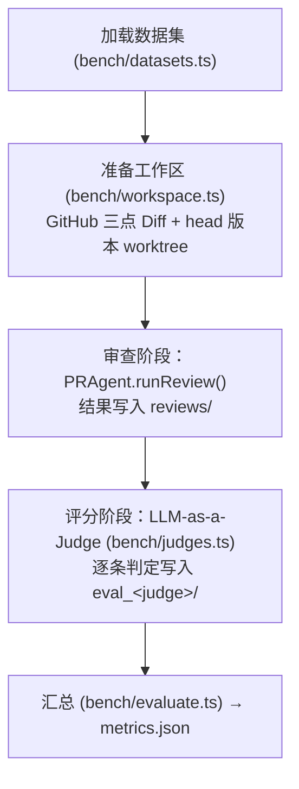

# 基准评测指南

> 本文说明如何在 AACR-Bench 与 Martian Benchmark 上运行 PR-Agent，以及各项指标的计算口径。

## 1. 数据集

评测代码位于 [`bench/`](../../bench/)。数据集固定到具体版本，首次运行时下载并缓存到 `bench/.cache/`。

### 1.1 AACR-Bench

- **来源**：[Alibaba-Aone/aacr-bench](https://huggingface.co/datasets/Alibaba-Aone/aacr-bench)，固定到一个 revision，并校验 SHA256。
- **规模**：200 个真实 GitHub PR 上的 2,145 条评论，其中 `label=1` 的 1,505 条经专家确认，作为参考答案；没有任何确认评论的 PR 会被跳过。
- **指标**（与官方 `file_semantic` 口径一致）：
  - 每条生成评论与**同一文件**内的参考评论交给 Judge，判断语义上是否指出了同一问题。
  - **Precision** = 覆盖到新参考评论的生成评论数 ÷ 生成评论总数（按生成顺序去重：多条评论命中同一参考评论时只算一条）。
  - **Recall** = 被覆盖的参考评论数 ÷ 参考评论总数。
  - **Balanced Score** = Precision 与 Recall 的调和平均（F1）。

### 1.2 Martian Benchmark

- **来源**：[withmartian/code-review-benchmark](https://github.com/withmartian/code-review-benchmark) 的离线集，固定到具体 commit。
- **规模**：5 个仓库中的 50 个 PR，173 条人工确认的参考评论，评论只到 PR 级，不带行号。
- **指标**：参考评论与生成评论两两交给 Judge，取置信度最高的匹配；未匹配任何参考评论的生成评论计为误报。按问题类别分三个 profile 计分：
  - `strict`：bug / security / concurrency / data / api
  - `core`（默认）：`strict` 加 perf / test_gap / doc_defect
  - `all`：`core` 加 style / speculative

## 2. 流水线



- **真实代码上下文**：默认 `--repo-mode checkout` 会检出 PR 的 head 版本，Agent 的 `read_file` / `grep_code` 读取的就是被审查的代码。`diff-only` 模式给出一个空目录，只用 Diff 审查。
- **Diff 来源**：始终使用 GitHub 的三点 Diff（merge-base...head），也就是 PR 本身的改动。
- **阶段解耦**：审查结果落盘后，可以只重跑评分阶段，例如更换 Judge 模型时不必重新审查。
- **续跑**：复用同一个 `--run-id` 时，已成功的审查和已完成的评分会被跳过，未成功的实例重新执行；`--force` 强制重做。`run.json` 保留首次运行的版本与配置，每次续跑追加到 `resumes`。

## 3. 可复现性与口径

- **配置**：每个实例都用 Schema 默认值加命令行参数（`--review-model`、`--max-cost`）构造 Agent，**不读取**仓库里的 `pr-agent.config.ts`，以免项目自定义规则影响分数。实际生效的完整配置（不含 API Key）写入 `run.json` 的 `agentConfig`。
- **代码版本**：`run.json` 记录 `git.commit`，以及 `src/`、`bench/` 是否有未提交修改（`git.dirty`）。有未提交修改时运行会给出警告，此时的分数无法对应到具体的代码版本。
- **两类失败分开处理**：
  - **Agent 失败（`error`）计入分母**：实例已准备好，但审查过程中出错（例如 LLM 调用重试后仍失败）。按"没有任何评论"计分，参考评论全部计为漏报，记录在 `failedReviewIds`，避免剔除困难样本而高估分数。
  - **无法准备（`unavailable`）不计入**：获取 PR 信息、Diff 或检出代码失败，属于数据或环境问题，与 Agent 能力无关。GitHub API 的 5xx、限流和网络错误会先退避重试（最多 4 次），git fetch 的网络错误也会重试；仓库改名或迁移时自动跟随跳转。仍然失败的实例（最常见的是数据集记录的 head commit 已被强推覆盖并被 GitHub 回收，上游和贡献者 fork 中都取不到）不进入任何分母，与原因一起列在 `unavailableInstances`。续跑同一个 run-id 时会再尝试一次。
  - 评分阶段要求所选实例都已有审查记录，否则直接报错。
- **截断情况**：每个文件组的停止原因都会记录下来（见[运行时架构](../architecture/runtime-architecture.md#停止原因mainloopstop)），并汇总到 `review.groupStopReasons`。除 `none` 以外的停止原因越多，说明预算、轮次或错误对结果的影响越大。
- **Judge 偏差**：审查模型与 Judge 模型相同时会给出警告。默认组合是审查用 `deepseek-flash`、Judge 用 `deepseek-v4-pro`。

## 4. 命令

```bash
# AACR-Bench：固定种子随机抽取 20 个 PR
vp run bench -d aacr -n 20 --seed 42 --run-id aacr-sample-20

# 每个 PR 的花费上限设为 0.5 美元（默认 1 美元）
vp run bench -d aacr -n 20 --seed 42 --max-cost 0.5 --run-id aacr-sample-20-cap05

# 复用已有审查结果，只用另一个 Judge 重新评分
vp run bench -d aacr --run-id aacr-sample-20 --stage eval --judge-model deepseek-v4-pro

# 指定实例
vp run bench -d aacr --ids "filamentphp__filament@d47632c" --run-id smoke

# Martian 全量
vp run bench -d martian --run-id martian-full

# 只用 Diff，不检出仓库
vp run bench -d aacr -n 10 --repo-mode diff-only --run-id aacr-diff-only
```

其余参数：`--stage all|review|eval`、`-c/--concurrency`（并行审查数，默认 2）、`--judge-concurrency`（默认 8）、`--trace`（审查阶段上报到 Phoenix）。读取 GitHub API 时使用 `GITHUB_TOKEN` / `GH_TOKEN`，没有时尝试 `gh auth token`。

## 5. 产物

结果写入 `bench/results/<dataset>/<run-id>/`：

```text
run.json                     # 数据集、实例列表、git 版本、生效的 Agent 配置
reviews/<instance>.json      # 每个实例的评论、Token、花费、各文件组停止原因
eval_<judge>/<instance>.json # 逐条判定及 Judge 给出的理由
eval_<judge>/metrics.json    # 汇总指标
```

`metrics.json` 的主要字段：

| 字段                                 | 含义                                                                     |
| :----------------------------------- | :----------------------------------------------------------------------- |
| `scores`                             | Precision / Recall / Balanced Score（或 Martian 各 profile 的 tp/fp/fn） |
| `failedReviewIds`                    | Agent 审查失败、按零评论计分的实例                                       |
| `unavailableInstances`               | 无法准备、不参与计分的实例及原因                                         |
| `judgeCalls` / `judgeCallFailures`   | Judge 调用次数与最终失败次数                                             |
| `review.avgDurationSec`              | 平均每个 PR 的审查耗时                                                   |
| `review.totalCostUsd` / `avgCostUsd` | 审查总花费与平均每个 PR 的花费                                           |
| `review.groupStopReasons`            | 各停止原因出现的文件组数                                                 |
